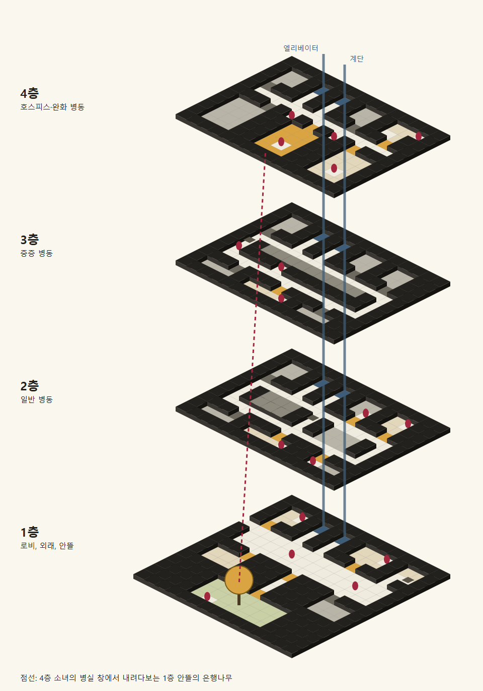
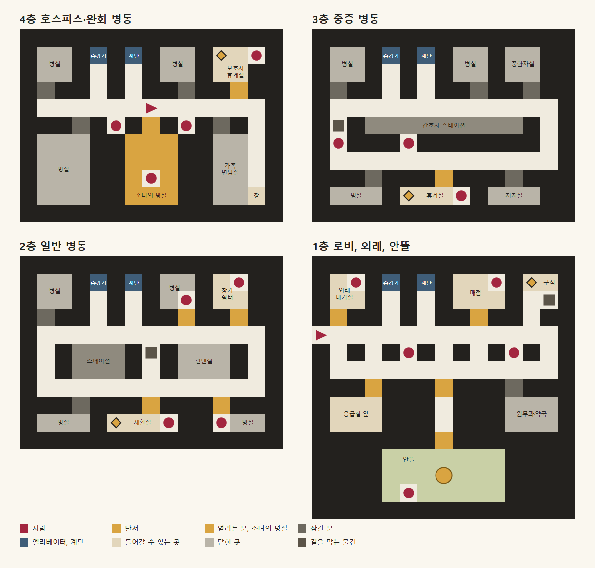

# 병원 지도 (초안)

> 병원을 **1인칭으로 걸어 다니는 방식**의 공간 설계다. 그림은 임시지만 움직임은 만들어져 있다(아래 "지금 된 것"). 지도 데이터는 `src/features/visit/hospitalMap.ts`에 있다. 걷기, 정문에서 4층까지 걸어가기, 왼쪽 위의 목표, 지도 버튼의 빠른 이동, 인물과의 대화는 사용자의 결정이다. 지도와 인물의 구체적인 내용과 그리는 방법은 Claude의 제안이다. 게임의 나머지 설정은 `계획서.md`에 있다.



## 지금 된 것

**된 것:** 네 층 모두 걷기와 돌기, 키보드(방향키, WASD, Enter), 엘리베이터와 계단, 왼쪽 위 목표와 방향 화살표, 지도와 빠른 이동, 정문에서 병실까지 이어지는 하루, 16명과의 대화, 매점과 단서, 날마다 변하는 창의 빛. WebGL을 쓸 수 없으면 평면도로 대신 걷는다.

**아직 안 된 것:**

- 그림은 코드로 그린 임시 잉크다.
- 인물의 대사는 대부분 한 벌이다. 단서가 있는 날만 달라지고, 세 번 달라지는 이야기와 청년의 퇴원은 없다.
- 엘리베이터와 계단은 검은 화면으로 넘어간다. 계단에서 카메라가 오르내리는 연출은 없다.
- 1층 안뜰에서 실제로 위를 올려다보는 시점은 없다. 글로만 알려 준다.
- 실제 휴대폰에서 시험하지 않았다.

## 왜 걷는가

**지금은 게임 안에 머무는 시간이 너무 짧다.** 병실 대화가 끝나면 할 일이 금방 끝난다. 병원을 직접 걷고 사람들과 이야기하면서 하루를 보내게 하는 것이 이 기능의 목적이다.

## 하루의 움직임

```
1층 정문에서 시작 → 걸어서 4층 소녀의 병실로 → 대화 → 쫓겨나서 병실 앞 복도
  → 병원을 자유롭게 돌아다니기 (매점, 단서, 사람들) → 정문으로 나가거나 타이틀로
```

- 첫날에는 정문에서 병실 문까지 직접 걷는다. 칸 수로 약 14칸이고, 그사이에 엘리베이터나 계단을 탄다.
- 마지막 날은 쫓겨나지 않고 바로 엔딩으로 간다.

## 움직이는 방식

- 화면은 둠이나 방탈출 게임처럼 1인칭 복도 시점이다. 칸 단위로 움직인다.
- 화살표를 눌러 **한 칸 앞으로, 왼쪽으로 돌기, 오른쪽으로 돌기, 뒤돌기**를 한다. 문, 물건, 사람은 화면에서 직접 누른다.
- 한 칸은 약 0.3초, 돌기는 약 0.25초 동안 부드럽게 이어진다. 그림이 뚝뚝 바뀌지 않는다.
- 시간 제한, 실패, 전투는 없다.

## 화면에 늘 있는 것

| 위치 | 내용 |
| :---- | :---- |
| **왼쪽 위** | **지금의 목표와 방향.** 글 한 줄과, 내가 보는 방향을 기준으로 다음에 갈 쪽을 가리키는 화살표 |
| 오른쪽 위 | **지도 버튼** |
| 아래 | 이동 화살표 |

**목표의 예**

| 언제 | 목표 |
| :---- | :---- |
| 도착했을 때 | 4층 소녀의 병실로 가기 |
| 쫓겨난 뒤 | 병원 둘러보기. 매점에 아직 안 갔으면 "1층 매점에서 선물 고르기" |
| 2회차, 단서가 있는 날 | 쪽지에 적힌 층과 단서 |
| 돌아갈 때 | 1층 정문으로 나가기 |

화살표는 지도에서 길을 계산해서 가리킨다. 막힌 곳이 있으면 돌아가는 쪽을 가리킨다. 다만 2층 재활실처럼 **찾는 재미가 있는 곳은 층까지만 알려 준다.**

**지도와 빠른 이동**

- 지도 버튼을 누르면 층별 평면도와 지금 위치가 보인다.
- 층을 누르면 그 층의 엘리베이터 앞으로 바로 간다.
- **한 번 걸어서 가 본 층만 빠른 이동이 된다.** 첫날의 걷기가 건너뛰어지지 않고, 그 뒤로는 힘든 날에 바로 올라갈 수 있다.
- 지도에는 지금 층의 평면도와 내 위치가 보인다.

## 지도 읽는 법

글자 하나가 한 칸이다. **모든 층의 크기가 같고, 엘리베이터와 계단은 같은 자리에 있다.** 한 건물이어야 층끼리 맞물리기 때문이다.

| 기호 | 뜻 |
| :---- | :---- |
| `#` | 벽 |
| `.` | 걸을 수 있는 복도 |
| `+` | 열리는 문 |
| `=` | 잠긴 문 (들어갈 수 없음) |
| `%` | 길을 막는 물건 |
| `E` / `S` | 엘리베이터 / 계단 |
| 소문자 | 사람. 그 칸은 지나갈 수 없고, 바로 앞 칸에서 말을 건다 |



## 사람을 두는 규칙

- **길을 막지 않는다.** 복도의 움푹한 자리, 방 안쪽, 넓은 로비에 서 있다. 3층의 이송 요원만 침대와 함께 왼쪽 복도를 막지만, 반대로 돌아갈 수 있다.
- **병실에 있는 사람과는 문턱에서 이야기한다.** 병실 안으로 들어가 환자를 구경하지 않는다.
- **날마다 조금씩 달라진다.** 인물마다 7일 동안 세 번쯤 이야기가 바뀌어서, 다시 찾아갈 이유가 된다.
- **듣는 것이 중심이다.** 자유 입력은 없고 필요하면 고르기만 둔다. 플레이어의 마음을 묻거나 충고하는 일은 소녀와의 시간에만 맡긴다.
- **단서의 실마리를 흘린다.** 층마다 누군가 단서 근처의 이야기를 해서, 1회차에도 우연히 찾을 수 있다.
- **임종을 보여 주지 않는다.** 누군가 복도에서 사라진다면 이유는 퇴원뿐이다.

## 4층: 호스피스·완화 병동

조용하고 곧다. 퍼즐은 없다.

```
###############
#AA#E#S#BB#LLp#
#AA#.#.#BB#LL##
#=##.#.##=##+##
#......@......#
###=#n#+#v#=#.#
#CCC##GGG##DD.#
#CCC##GGG##DD.#
#CCC##GGG##DD.#
#CCC##GGG##DDW#
###############
```

| 기호 | 공간 |
| :---- | :---- |
| `G` | **소녀의 병실.** 문을 누르면 앞으로 걸어 들어가 병실 장면으로 이어진다. 창은 남쪽 안뜰을 향한다 |
| `@` | 쫓겨난 뒤 서 있는 자리 |
| `L` | 보호자 휴게실. **6일째 노래방 쿠폰**이 책 사이에 있다 |
| `W` | 복도 끝 창. 은행나무가 내려다보인다 |
| `A` `B` `C` | 다른 병실 (닫혀 있음) |
| `D` | 가족 면담실 (닫혀 있음) |

| 기호 | 사람 | 달라지는 것 | 예시 대사 |
| :---- | :---- | :---- | :---- |
| `n` | 담당 간호사 | 사무적이던 사람이 뒤로 갈수록 소녀의 하루를 먼저 말해 준다. 치료 내용은 말하지 않는다 | "보호자분은 아니시죠? 그래도 오늘 웃었어요, 그 아이." |
| `p` | 옆 병실 보호자 | 휴게실 책을 다 읽어 간다. 6일째에 쿠폰의 실마리 | "여기 책은 다 읽었어요. 사이에 별게 다 끼어 있더라고요." |
| `v` | 자원봉사자 | 꽃병 물을 갈아 준다. 소녀의 편지를 부쳐 준 사람이라는 것이 드러난다 | "우표값이 꽤 들었어요. 그 아이가 몇 통을 썼는지 아세요?" |

## 3층: 중증 병동

간호사 스테이션을 ㅁ자로 도는 순환 복도다.

```
###############
#AA#E#S#BB#II##
#AA#.#.#BB#II##
#=##.#.##=##=##
#.............#
#%#NNNNNNNNN#.#
#t###c#######.#
#.............#
###=###+###=###
#DDD#RRRb#QQQ##
###############
```

| 기호 | 공간 |
| :---- | :---- |
| `N` | 간호사 스테이션 |
| `R` | 휴게실. **3일째 과자봉지**가 의자 밑에 있다 |
| `I` | 중환자실 (닫혀 있음) |
| `Q` | 처치실 (닫혀 있음) |
| `A` `B` `D` | 병실 (닫혀 있음) |

**퍼즐:** 이동식 침대가 왼쪽 복도를 막고 있어서, 스테이션을 반대로 돌아가야 휴게실에 닿는다.

| 기호 | 사람 | 달라지는 것 | 예시 대사 |
| :---- | :---- | :---- | :---- |
| `N` | 3층 간호사 | 늘 바빠서 말이 짧다. 어느 날 처음으로 앉아 있다 | "지금은 안 돼요. 저기 의자에 앉아 계세요." |
| `t` | 이송 요원 | 침대 옆에서 기다린다. 사람을 옮기는 일의 소소한 이야기 | "이거 오늘 못 치워요. 반대로 돌아가세요." |
| `c` | 미화원 | 병원 곳곳의 사정을 안다. 3일째에 과자봉지의 실마리 | "휴게실 의자 밑 봉지요, 치우려다 말았어요. 일부러 둔 것 같아서." |
| `b` | 지친 보호자 | 처음엔 말이 없다가, 자기 감정에 이름을 붙이기 시작한다 | "미안한데, 화가 나요. 누구한테인지는 모르겠어요." |

## 2층: 일반 병동

복도 두 줄을 통로 세 개가 잇는 사다리 모양이다. 가장 헤매기 좋다.

```
###############
#AA#E#S#DD#Vh##
#AA#.#.#Dd#VV##
#=##.#.##+##+##
#.............#
#.#NNN#%#LLL#.#
#.#NNN#.#LLL#.#
#.............#
###=###+###+###
#FFF#YYYy##kJJ#
###############
```

| 기호 | 공간 |
| :---- | :---- |
| `Y` | 재활실. **4일째 운동화 끈**이 떨어져 있다 |
| `V` | 창가 쉼터 |
| `N` | 간호사 스테이션 |
| `L` | 린넨실 (닫혀 있음). 세탁 수레가 나오는 곳이다 |
| `D` `J` | 문턱에서 이야기할 수 있는 병실 |
| `A` `F` | 병실 (닫혀 있음) |

**퍼즐:** 재활실에는 표지판이 없다. 병실 사람들의 말을 듣고 위치를 알아낸다. 가운데 통로는 세탁 수레가 막고 있어 옆 통로로 돌아간다.

| 기호 | 사람 | 달라지는 것 | 예시 대사 |
| :---- | :---- | :---- | :---- |
| `d` | 곧 퇴원하는 청년 | 5일째에 퇴원한다. 그 뒤로는 침대에 쪽지만 남는다 | "재활실이요? 아래쪽 복도, 가운데 문이요. 저는 이제 안 가도 돼요." |
| `k` | 심심한 아이 | 끝말잇기를 건다. 이어 가다 보면 재활실 이야기가 나온다 | "끝말잇기 할래요? 이기면 재활실 어딘지 알려 줄게요." |
| `h` | 창가의 할아버지 | 혼자 장기를 둔다. 나중에는 판이 조금 달라져 있다 | "둘 줄 몰라도 돼요. 앉아만 있어요." |
| `y` | 물리치료사 | 4일째에 운동화 끈의 실마리 | "저 끈이요? 퇴원하는 분이 두고 가셨어요. 찾으러 안 오시네요." |

## 1층: 로비, 외래, 안뜰

게임이 시작되는 층이다. 기둥이 늘어선 넓은 공간이라 구석을 놓치기 쉽다. 안뜰은 건물 남쪽에 붙어 있다.

```
###############
#Oo#E#S#MMm#XX#
#OO#.#.#MMM#.%#
#+##.#.##+##.##
@.............#
#.#.#i#.#.#g#.#
#.............#
###+###+###=###
#HHH###.###RRR#
#HHH###.###RRR#
#######+#######
####YYYYYYY####
####YYYTYYY####
####YbYYYYY####
###############
```

| 기호 | 공간 |
| :---- | :---- |
| `@` | **정문. 매일 여기서 시작한다.** 병원 밖으로 걸어 나가지는 않고, 누르면 그날을 마친다 |
| `M` | 매점. 하루에 선물 1개 |
| `X` | 자판기 뒤 구석. **1일째 개목걸이**가 버려져 있다. `%`가 자판기다 |
| `O` | 외래 대기실 |
| `H` | 응급실 앞 |
| `R` | 원무과·약국 (닫혀 있음) |
| `Y` `T` | 안뜰과 은행나무. 나무 아래에서 올려다보면 4층 병실 창이 보인다 |

| 기호 | 사람 | 달라지는 것 | 예시 대사 |
| :---- | :---- | :---- | :---- |
| `i` | 안내 직원 | 층마다 무엇이 있는지 알려 준다. 처음 온 날의 길잡이 | "소녀 병실이요? 4층이에요. 엘리베이터는 저쪽이고요." |
| `g` | 경비 | 1일째에 개목걸이의 실마리 | "자판기 뒤에 뭐가 떨어졌던데, 손이 안 닿아요." |
| `m` | 매점 주인 | 전날 무엇을 샀는지 기억한다 | "어제 그거, 잘 줬어요?" |
| `o` | 외래의 어르신 | 번호를 기다린다. 올 때마다 다른 사람 이야기를 들려준다 | "번호가 안 불리네. 앉아요, 어차피 안 불려." |
| `b` | 안뜰 벤치의 할머니 | 은행잎 이야기. 뒤로 갈수록 잎이 줄어든다 | "이 나무가 나보다 늙었어. 잎 지는 건 매년 봐도 아깝더라." |

## 크기와 거리

`scripts/assets/draw-hospital-map.js`로 세었다(엘리베이터와 계단 칸 포함). 사람과 막는 물건을 지나갈 수 없게 두고도 단서와 사람 16명 모두에게 닿을 수 있다.

| 층 | 걸을 수 있는 칸 | 사람 | 엘리베이터에서 단서까지 |
| :---- | :---- | :---- | :---- |
| 4층 | 38 | 3 | 15칸 |
| 3층 | 38 | 4 | 25칸 |
| 2층 | 53 | 4 | 17칸 |
| 1층 | 82 | 5 | 14칸 |
| 합계 | 211 | 16 | |

## 입체감 있게, 서로 이어지게

칸마다 네 방향을 그림으로 그리면 211칸 × 4방향으로 **844장**이고, 장면마다 복도가 어긋나기 쉽다. 그래서 **지도 데이터 하나에서 모든 것을 만든다.**

```
지도 데이터 → 게임의 1인칭 공간
            → 지도 버튼의 평면도
            → 전체 맵 이미지
```

**1인칭 공간.** 지도의 칸으로 진짜 3D 벽과 바닥을 코드가 세우고, 거기에 잉크 질감 그림을 입힌다. Legend of Grimrock이나 세계수의 미궁과 같은 칸 이동 방식이다. 그림은 묶음 몇 장이면 된다(아래 "적은 메모리로 많이 표현하기"). 사람과 물건은 평평한 그림을 세워 둔다. 도구는 Three.js를 쓴다.

**공간이 이어지게 하는 것**

| 어디 | 어떻게 |
| :---- | :---- |
| 칸과 칸 | 카메라가 실제로 이동하고 회전해서 끊기지 않는다 |
| 문 | 문이 열리면 멈추지 않고 앞으로 걸어 들어간다. 소녀의 병실도 이렇게 2D 병실 장면으로 이어진다 |
| 엘리베이터 | 문이 닫히고, 층수가 바뀌고, 같은 자리에서 다른 층으로 문이 열린다 |
| 계단 | 앞으로 가면서 카메라가 올라가거나 내려간다 |
| 창 | 어느 층의 남쪽 창에서도 **같은 은행나무**가 보이고, 위층일수록 내려다본다. 1층에서는 올려다보면 4층 창이 보인다 |

**층이 구별되게 하는 것.** 그림체는 층 모두 같게 두고, 벽의 층수 표시와 소품, 사람의 수, 밝기로 구별한다. 위로 갈수록 사람이 줄고 조용해진다. 창의 빛은 지금처럼 날마다 회색에서 호박색으로 변한다.

**전체 맵 이미지.** 위의 두 그림은 `node scripts/assets/draw-hospital-map.js`로 지도에서 바로 만든다. 지도를 고치면 그림도 맞게 다시 나온다. 게임에 넣을 때는 잉크 질감만 입힌다.

**아직 모르는 것.** 휴대폰에서 부드럽게 도는지는 시험하지 않았다.

## 적은 메모리로 많이 표현하기 (제안)

**메모리는 거의 전부 그림이 쓴다.** 우리 지도로 재 보면 네 층의 벽, 바닥, 천장을 모두 합쳐 794면, 삼각형 1,588개이고 정점 데이터는 약 62KB다. 흑백 1024×1024 그림 한 장(GPU 1.33MB)이 건물 전체의 구조보다 훨씬 크다. 그래서 **구조는 마음껏 쓰고, 그림의 장수를 줄인다.**

**1. 색을 그림에 넣지 않는다.** 그림은 흑백 1채널로 저장하고 색은 화면에 그릴 때 계산한다. 같은 크기의 RGBA보다 GPU 메모리가 4분의 1이다. 층의 밝기, 날마다 회색에서 호박색으로 변하는 빛, 해피엔딩에서 색이 돌아오는 순간이 **그림을 더 만들지 않고** 숫자 하나로 된다. 둠이 COLORMAP으로 빛의 단계를 표현한 것과 같은 발상이다.

**2. 그림은 넉 장의 묶음으로 만든다.** 그림을 한 장에 모아 두면(아틀라스, 트림 시트) 전환 비용도 줄어든다.

| 묶음 | 내용 | GPU |
| :---- | :---- | :---- |
| 구조 | 벽, 바닥, 천장, 문, 창틀, 걸레받이. 벽은 변형 4종 | 1.33MB |
| 붙이는 그림 | 층수 표시, 게시물, 의자, 소독제, 얼룩, 금 간 곳 | 1.33MB |
| 사람 | **지금 층의 사람만** (층별 1장, 층을 옮길 때 교체) | 1.33MB |
| 그 층의 주인공 공간 | 은행나무, 스테이션, 재활 기구 같은 큰 소품 | 1.33MB |
| 합계 | 한 번에 올라가는 양 | **약 5.3MB** |

**3. 알파 채널을 쓰지 않는다.** 사람과 소품 묶음에서는 완전한 검정(값 0)을 "아무것도 없음"으로 약속한다. 그림은 흑백 1채널 그대로다.

**4. 데이터로 늘린다.** 그림을 새로 그리지 않고 지도 데이터에서 다음을 정한다.

- **변형:** 칸 좌표로 벽 변형과 좌우 반전을 고른다. 변형 4종 × 반전 = 8가지로 보여서 복도가 복사한 것처럼 보이지 않는다.
- **조합:** 벽 위에 붙이는 그림을 칸마다 지정한다. 둠이 패치를 조합해 벽 질감을 만든 방식이다. "얼룩 + 게시물 + 소독제"가 한 칸의 개성이 된다.
- **사람:** 몸과 머리를 나눈다. 간호사 옷처럼 같은 옷을 함께 쓴다. 말할 때는 같은 그림을 확대한다.
- **날마다:** 같은 칸에서 붙이는 그림과 사람만 바꾼다. 안뜰의 잎 수, 할아버지의 장기판, 퇴원한 청년의 쪽지가 그림 한 장씩으로 끝난다.

**5. 안개로 멀리 안 그린다.** 약 6칸 너머는 어둠이나 종이색으로 사라지게 한다. 사일런트 힐이 짧은 시야를 안개로 가린 방식이고, 이 게임의 조용한 분위기에도 맞는다. 다른 층은 아예 불러오지 않는다.

**6. 공간마다 주인공을 하나만 둔다.** 장소의 차이는 모양이 아니라 소품 두세 개와 빛으로 만든다.

| 공간 | 재사용 | 새로 그리는 것 |
| :---- | :---- | :---- |
| 복도, 닫힌 병실 문 | 구조 묶음 전부 | 없음 (붙이는 그림만) |
| 보호자 휴게실, 3층 휴게실 | 구조, 의자 | 책장 또는 자판기 하나 |
| 재활실 | 구조 | 평행봉 |
| 창가 쉼터 | 구조, 의자, 창 | 장기판 |
| 매점 | 구조 | 진열대 |
| 복도 끝 창, 남쪽 창 | 창틀 | 창밖의 은행나무 |
| 안뜰 | 없음 | 땅, 벽, 은행나무, 벤치 |
| 소녀의 병실 | 2D 병실 장면 | 지금 계획대로 |

**쓰지 않기로 한 방법**

- **칸마다 그림 844장:** 어긋나기 쉽고 부드럽게 돌 수 없다.
- **던전 마스터식 거리별 그림:** 거리마다 벽 그림을 미리 그려 겹치는 방식이라 손그림 느낌은 가장 좋다. 하지만 부드러운 이동과 회전이 안 되고, 벽 종류마다 거리별 그림이 필요하다.
- **화면 전체를 1비트로 바꾸기(오브라 딘):** 그림이 싸게 통일되지만, 움직일 때 점 무늬가 흔들리는 문제가 있어 개발자도 많은 공을 들였다. 후처리 비용도 더해진다. 첫 시험에서는 빼고, 그림만으로 부족할 때 시험한다.

**코드 크기.** Three.js는 빌드에서 별도 파일로 나뉘어 병원 화면에 들어갈 때만 불러온다. 크기는 840KB, gzip으로 약 193KB다. 필요한 부분만 묶는 도구로 쟀을 때의 132KB보다 크다. 지금은 묶음 세 장(구조, 사람, 소품), GPU 약 4MB를 쓴다.

**아직 재지 못한 것.** 위의 GPU 수치는 계산값이다. 실제 휴대폰의 프레임과 흑백 WebP 파일의 크기는 시험해야 안다.

## 주의할 점

- 다른 환자의 고통을 구경거리로 만들지 않는다. 그래서 병실 대부분은 닫혀 있고, 말을 거는 곳도 문턱까지다.
- 사람들의 이야기는 소녀보다 앞에 서지 않는다. 한 사람의 대사는 짧게 두고, 무거운 이야기(지친 보호자, 호스피스 자원봉사자)는 공개 전 전문가 감수에 포함한다.
- 인물 16명이 세 번씩 달라지면 대화 장면이 약 48개다. 사람 그림도 16장 이상 필요하다.
